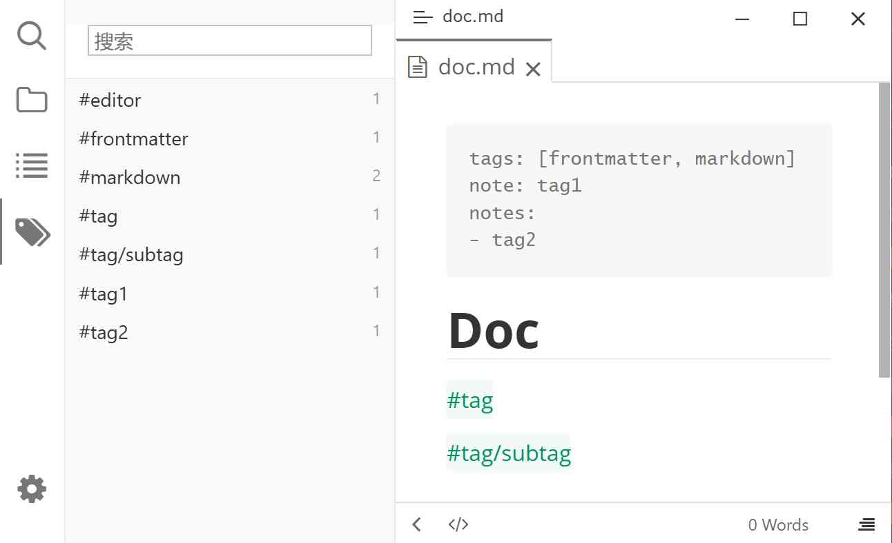

# Typora Plugin Tag

English | [简体中文](./README.zh-CN.md)

A [Typora](https://typora.io) plugin developed based on [typora-community-plugin](https://github.com/typora-community-plugin/typora-community-plugin), supporting `#tag` style tags.

## Features

- **Tag Toggle** — Use keyboard shortcuts to quickly convert text into styled tags
- **Input Suggestions** — Automatically show autocomplete suggestions for existing tags when typing `#`
- **Tag Panel** — Sidebar tag management panel with tag counts, search and delete support
  - **Tag Counts** — Each tag shows its occurrence count across all documents on the right
  - **Metadata Integration** — Automatically recognizes the tags field in YAML Frontmatter and `#tag` in the body text based on the built-in Metadata plugin; shows a notice and disables search when the plugin is disabled
- **Multi-language Support** — Simplified Chinese, English, German

## Preview

## Installation

1. Make sure [typora-community-plugin](https://github.com/typora-community-plugin/typora-community-plugin) is installed
2. Search for `Tag` in Typora's **Preferences > Plugins** and click install

## Usage

### Toggle Tag Style

<kbd>Ctrl</kbd>+<kbd>Alt</kbd>+<kbd>T</kbd> — Toggles the text at the cursor position or selected text between plain text and tag style. If the current text is already in tag style, it will be removed; otherwise, it will be converted to `#tag` format.

### Tag Panel

Click the **Tag Icon** (🏷) in the sidebar to open the tag management panel:

- **Search Tags** — The input box supports real-time filtering of tags (sticky while scrolling)
- **Tag Counts** — Each tag shows its occurrence count on the right
- **Search Documents** — Hover over a tag and click the left 🔍 icon to search for all documents containing that tag
- **Delete Tag** — Hover over a tag and click the right 🗑 icon to remove the tag

> The tag panel depends on the built-in **Metadata** plugin. If it is disabled, the panel shows a notice and disables search and the list.

### Input Suggestions

After enabling the **Input Suggestions** option in preferences, typing `#` while editing will automatically display an autocomplete list of existing tags for easy insertion of already created tags.

## Configuration

Open Typora **Preferences > Plugin Configuration**, find the Tag plugin to see the following configuration options:

| Configuration | Description |
|---------------|-------------|
| Input Suggestions | When enabled, typing `#` will trigger tag autocomplete suggestions |
